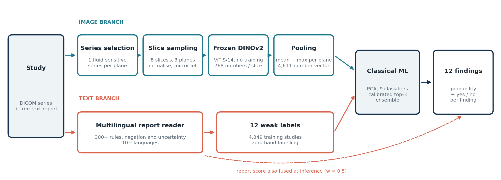
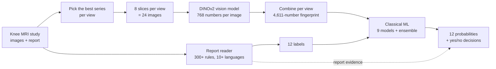
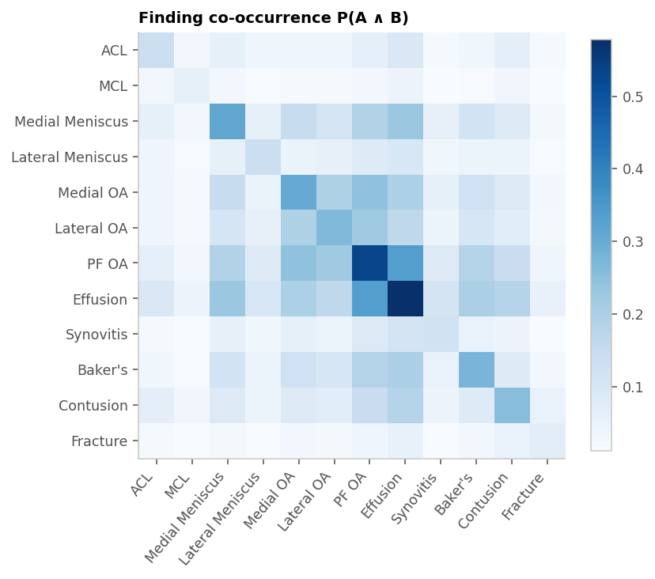
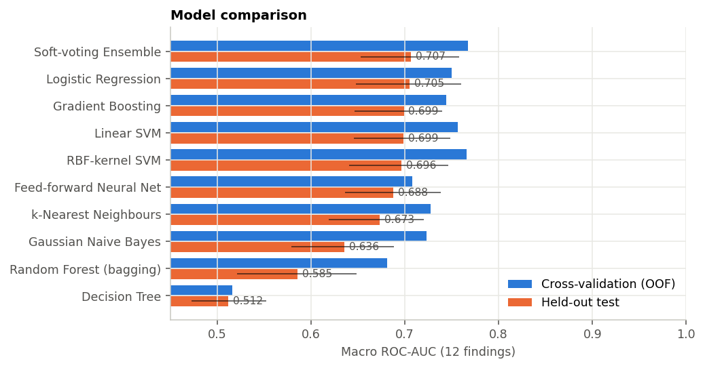
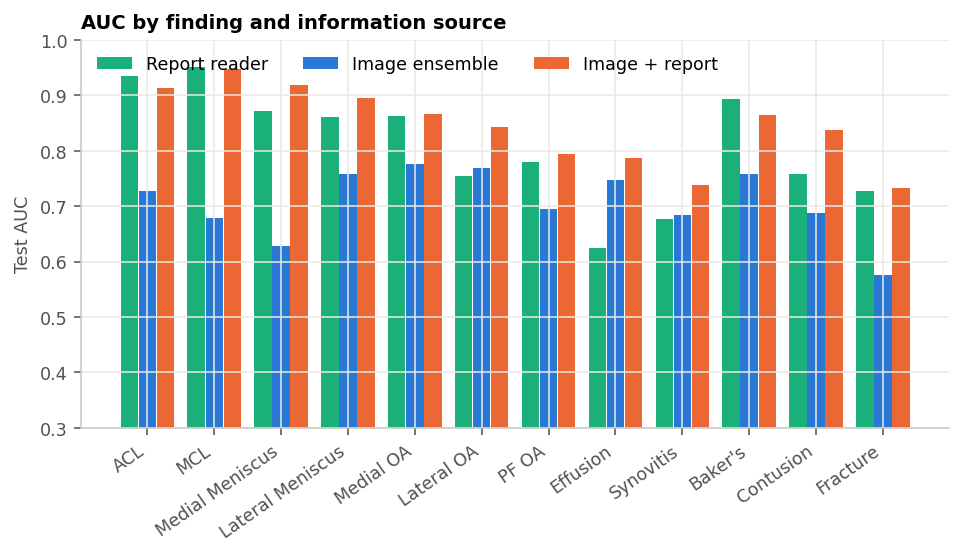
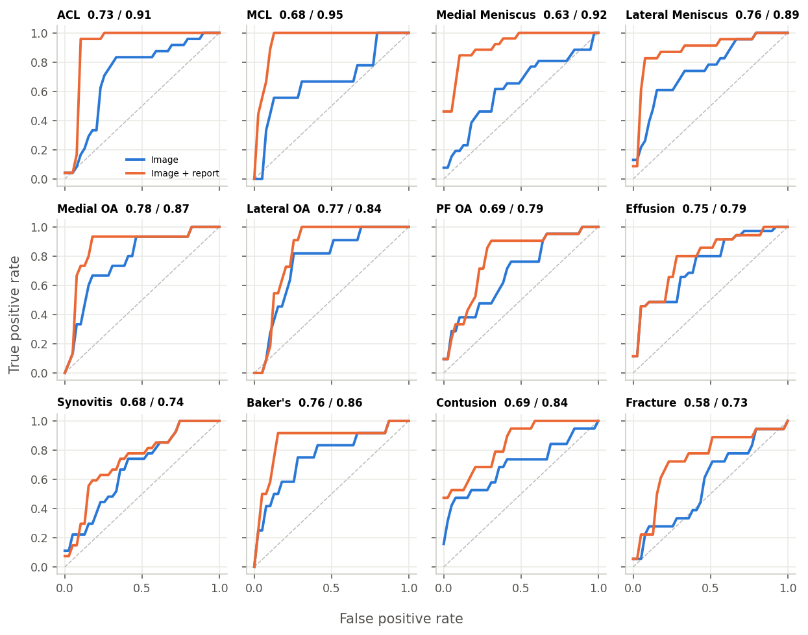
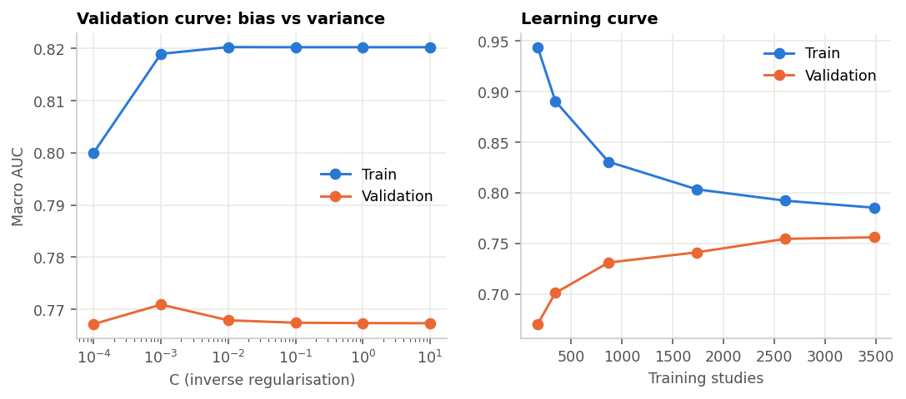
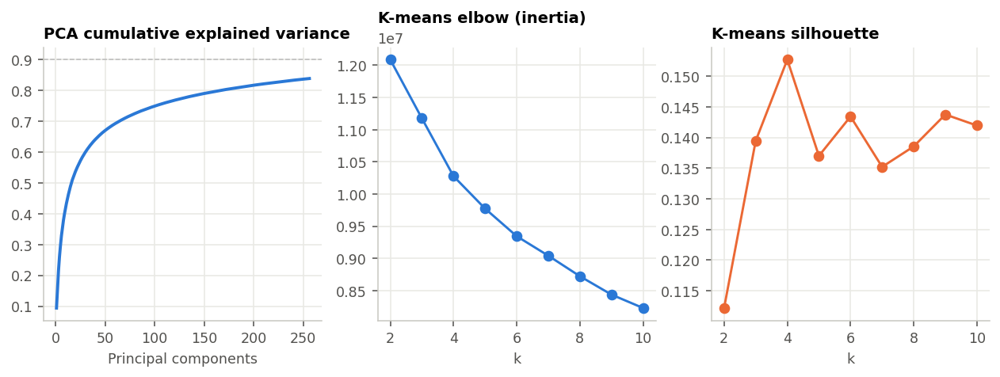

# KneeML: Knee MRI Abnormality Detection

**KneeML reads a knee MRI scan and tells you, in under two seconds on an ordinary laptop, how likely
each of 12 common knee problems is.** It learned from the complete ~250 GB knee MRI archive by
reading the radiology report attached to every scan, so no one had to label a single image by hand.

| **0.845** | **80.6%** | **88.5%** | **0.95** | **1.9 s** |
|:---:|:---:|:---:|:---:|:---:|
| ROC-AUC (images + report) | accuracy across 12 findings | right when it says "no" | best finding (MCL tear) | per study on a laptop CPU |

*All results are measured on an independent radiologist-verified test set that the models never saw
during development.*

**Read more:** [Full documentation](docs.md) · [IEEE paper draft](research-paper-draft.md) ·
[Technical report](technical.md) · [Plain-language story](how-we-did-it.md) · [One-page pitch](pitch.md)

---

## Contents

- [The problem in one minute](#the-problem-in-one-minute)
- [The idea](#the-idea)
- [How it works](#how-it-works)
- [The data](#the-data)
- [The machine-learning methods](#the-machine-learning-methods)
- [Results](#results)
- [Beyond the classifier](#beyond-the-classifier)
- [The web app](#the-web-app)
- [Run it yourself](#run-it-yourself)
- [Project layout](#project-layout)
- [Roadmap](#roadmap)

---

## The problem in one minute

A knee MRI is a stack of images taken in three directions:

| View | What you see | Best for spotting |
|---|---|---|
| **Sagittal** | the knee from the side | ACL tears, meniscus tears, joint fluid |
| **Coronal** | the knee from the front | MCL tears, meniscus tears, arthritis |
| **Axial** | the knee from above | kneecap arthritis, Baker's cysts, inflamed lining |

A radiologist scrolls through hundreds of these images and decides on **12 findings at once**:

`ACL tear` · `MCL tear` · `Medial meniscus tear` · `Lateral meniscus tear` ·
`Medial arthritis` · `Lateral arthritis` · `Kneecap arthritis` · `Joint fluid (effusion)` ·
`Inflamed lining (synovitis)` · `Baker's cyst` · `Bone bruise` · `Fracture`

A knee can have any combination, so the computer answers **12 separate yes/no questions** per scan.

## The idea

Normally an AI like this needs thousands of scans that experts have labelled one by one, which is
slow and expensive. KneeML takes a shortcut that every hospital already has: **the written report**.
Every scan comes with a radiologist's report ("complete tear of the ACL", "no joint fluid"), and
KneeML reads those reports, in more than ten languages, to create its own training labels.

Three simple moves:

1. **Read the reports** → 12 yes/no labels for every scan, automatically.
2. **Turn each scan into numbers** → a pretrained vision model (DINOv2) describes 24 key images
   per scan as a 4,611-number "fingerprint".
3. **Learn the link** → nine classic machine-learning models learn which fingerprints mean which
   findings; the best three vote together.

## How it works





### Step 1: reports become labels
`kneeml/report_labeler.py` scans each report for a body part next to a problem word (for example
*medial meniscus* + *tear / rotura / Riss / scheur / yırtık*). It understands negation ("no",
"without", "intact", in every language), treats "possible" or "suspected" as half-sure, and ignores
the referring doctor's question ("rule out ACL tear?"). Result: **12 labels for every study, zero
hand-labelling.**

### Step 2: scans become numbers
`kaggle/extract/extract_features.py` runs once on a GPU (about 35 minutes for the whole archive,
zero failures):

1. For each view, pick the series where fluid and swelling show up brightest.
2. Take **8 evenly spaced slices** from the middle of the stack (24 per scan).
3. Even out brightness, resize to 256 × 256, and mirror left knees so every knee faces the same way.
4. Feed each slice to **DINOv2**, a powerful pretrained vision model, used as-is. It returns
   **768 numbers** describing the slice.
5. Average and max-pool the slices of each view → **4,611 numbers per scan**.

### Step 3: learn, calibrate, combine
Each model is the same simple pipeline: **standardise → PCA (compress to the most informative
64–128 directions) → classifier**, one per finding. The three best models are calibrated (so "70%"
means the same thing for each) and averaged. When a report is available, the image score and the
report score are blended 50/50.

## The data

| | |
|---|---|
| **Source** | public, de-identified, multi-centre knee MRI archive with radiology reports |
| **Size** | ~250 GB of DICOM |
| **Studies** | 4,407, every one used |
| **Image series** | 24,371 (9,864 sagittal · 8,609 coronal · 5,898 axial) |
| **Slices processed** | 105,840 |
| **Report languages** | 10+ (Spanish, English, German, Dutch, French, Portuguese, Turkish, Croatian, Bulgarian, Greek, ...) |
| **Labels** | 12 per study, generated automatically from the reports |

The working dataset is derived from the complete archive and follows it study for study. Medical
images are never committed to this repository (`data/` is git-ignored).


*How often two findings appear in the same knee: arthritis spreads across compartments, and
fractures come with bone bruises.*

## The machine-learning methods

| Method | The idea in one line |
|---|---|
| Logistic regression | the best straight dividing line between "yes" and "no" |
| Gaussian Naive Bayes | Bayes' rule: how likely is a tear given these numbers? |
| k-Nearest Neighbours | copy the answers of the most similar past scans |
| Linear SVM | a dividing line pushed as far as possible from both groups |
| RBF-kernel SVM | the same, but the line can curve |
| Decision tree | a chain of simple questions |
| Random Forest | hundreds of trees voting (bagging) |
| Gradient boosting | trees added one by one, each fixing the last one's mistakes |
| Neural network (MLP) | a small network of connected neurons |
| **Soft-voting ensemble** | **the best three (RBF SVM, linear SVM, logistic regression), averaged** |

**Built to be trusted:**
- **Independent test set:** radiologist-verified studies are never used for training, tuning or
  choosing thresholds.
- **Grouped 5-fold cross-validation:** studies that share a report always stay together, so nothing
  leaks.
- **Platt calibration:** every model outputs a meaningful probability.
- **A threshold per finding:** rare and common findings each get their own cut-off.
- **95% confidence intervals** from 1,000 bootstrap resamples.


*Every model compared on cross-validation and on the test set; the calibrated ensemble leads.*

## Results

### Headline

| Metric | Images + report |
|---|---:|
| Macro ROC-AUC | **0.845** (95% CI 0.805–0.881) |
| Accuracy (696 yes/no decisions) | **80.6%** |
| Negative predictive value | **88.5%** |
| Macro recall | **81.6%** |

Images and reports carry complementary evidence; together they beat either one alone.



### Per finding (images + report)

| Finding | AUC | Accuracy | "No" calls correct |
|---|---:|---:|---:|
| MCL tear | **0.948** | 91.4% | **97.8%** |
| Medial meniscus tear | **0.918** | 87.9% | 87.9% |
| ACL tear | **0.913** | **93.1%** | **96.9%** |
| Lateral meniscus tear | 0.894 | 86.2% | 84.6% |
| Medial arthritis | 0.867 | 84.5% | **97.2%** |
| Baker's cyst | 0.864 | 87.9% | **97.6%** |
| Lateral arthritis | 0.843 | 79.3% | 92.7% |
| Bone bruise | 0.837 | 69.0% | 92.0% |
| Kneecap arthritis | 0.794 | 75.9% | 89.7% |
| Joint fluid | 0.788 | 69.0% | 77.8% |
| Synovitis | 0.737 | 69.0% | 65.9% |
| Fracture | 0.733 | 74.1% | 82.1% |


*One ROC curve per finding. The closer to the top-left corner, the better.*

### Real examples

| Study | The knee | Result |
|---|---|---|
| K053 | Acute sports injury, report in **Turkish** | **12 / 12**: the report lifts the ACL score from 17% to 58% |
| K052 | Worn knee with **8 findings** at once | **12 / 12**: every finding found, no false alarms |
| K004 | ACL + MCL + meniscus torn together | **5 → 11 / 12**: the report confirms all three tears |
| K027 | **9 findings** in one knee | **11 / 12 from the images alone** |

### Through the live web app
Running the test set through the exact code the website uses gives **80.3% accuracy** at a median of
**1.9 seconds per study** on a laptop CPU, matching the offline evaluation.

## Beyond the classifier

- **Learning behaviour.** The regularisation sweep finds the sweet spot between under- and
  overfitting, and validation AUC keeps climbing as training data grows (0.670 → 0.756).

  

- **Clustering** (K-means, K-medoids, hierarchical, DBSCAN) organises the archive by scanner
  protocol, which confirms that KneeML's label-driven design is the right one.

  

- **Association rules (Apriori)** rediscover clinical knowledge from the data alone: a fracture comes
  with a bone bruise 73% of the time (2.9× more often than chance), and arthritis in two
  compartments predicts the third (lift 2.74).

## The web app

A local web app (FastAPI + React) with four tabs:

| Tab | What it does |
|---|---|
| **Inference** | Scroll through a study's MRI slices (play, brightness, contrast), see all 12 probabilities next to the expert answer, and click any finding for a plain-language explanation of the call |
| **Results** | Every metric and chart, interactive |
| **Figures** | Every training figure with "what it shows / how to read it / why it matters" |
| **Method** | The pipeline and the course topics it covers |

You can also upload your own slices (PNG, JPG or DICOM) and an optional report.

## Run it yourself

```bash
pip install -r requirements.txt
python -m pytest tests -q

# build and start the web app
cd frontend && npm install && npm run build && cd ..
uvicorn backend.app:app --port 8010          # open http://localhost:8010
```

The app shows the saved test-set results straight away. For live inference, run the full pipeline
below first. For frontend development, run `npm run dev` in `frontend/` (it proxies `/api` to port 8010).

### Full pipeline

```bash
echo <data-source-slug> > data/kaggle_source.txt
python kaggle/push_extract.py --fetch-metadata   # reports + metadata -> data/raw
python kaggle/push_extract.py --shards 2         # DINOv2 features on a GPU (~35 min)
python kaggle/push_extract.py --download         # -> data/features
python -m kneeml.train                           # all supervised experiments + model bundle
python -m kneeml.analysis                        # clustering + Apriori
python -m kneeml.plots                           # figures in results/figures
python -m kneeml.demo                            # test studies for the web app
python -m kneeml.batch_inference                 # end-to-end check through the web pipeline
```

## Project layout

```text
kneeml/            Python package
  report_labeler.py  multilingual report reader -> 12 labels per study
  data.py            fingerprints + labels -> training table
  models.py          the 9 models (scaler -> PCA -> classifier) + calibration
  train.py           all supervised experiments -> results/metrics.json
  analysis.py        PCA, SVD, clustering, Apriori -> results/unsupervised.json
  plots.py           figures -> results/figures/
  inference.py       single-study inference used by the web app
kaggle/            one-off GPU feature extraction
backend/           FastAPI service
frontend/          React + Vite web app (Inference | Results | Figures | Method)
results/           metrics JSON and figures
tests/             pytest suite
docs.md            full documentation
research-paper-draft.md   IEEE-format paper draft (LaTeX)
```

## Roadmap

- A learned text model on top of the report rules for even richer labels
- An MRI-specific encoder and full 3D context
- A larger radiologist-verified set and active learning
- Slice-level heat-maps showing *where* the model is looking
- A clinical reader study measuring how much faster radiologists become with KneeML

---

*Educational research project built for an end-semester machine-learning course.*
