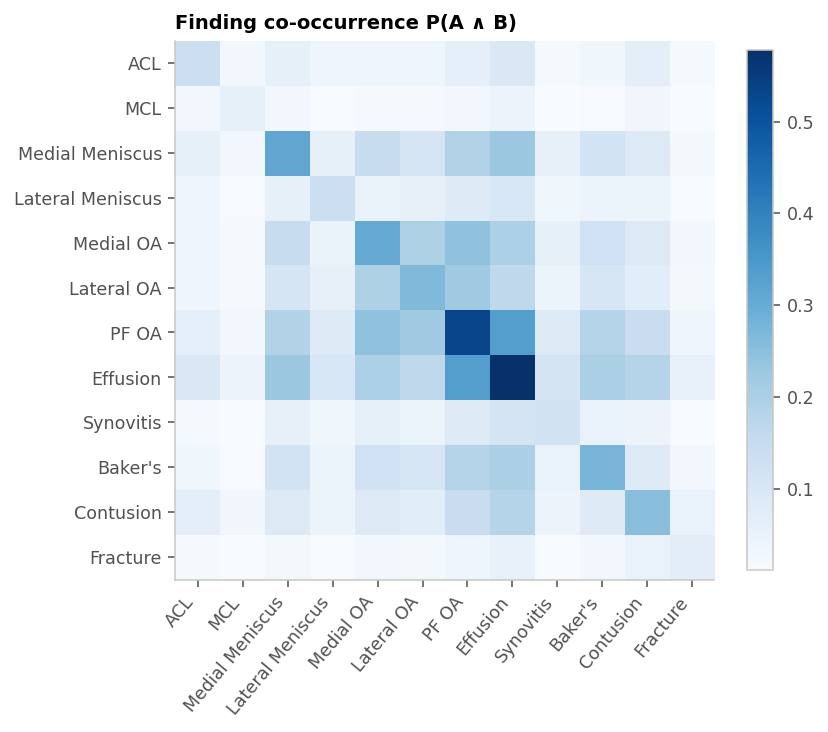
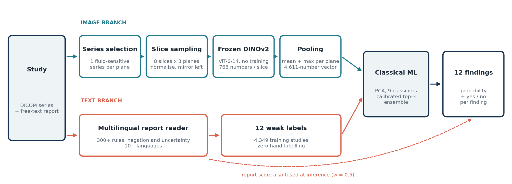
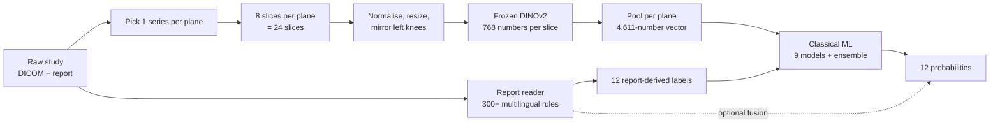
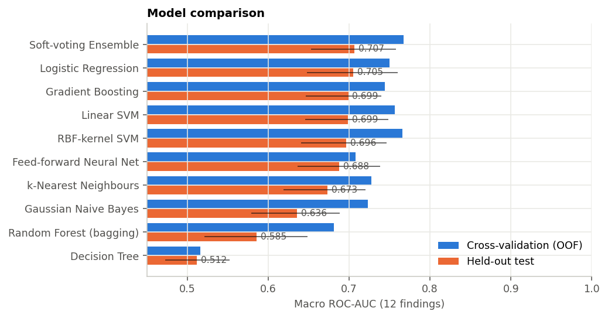
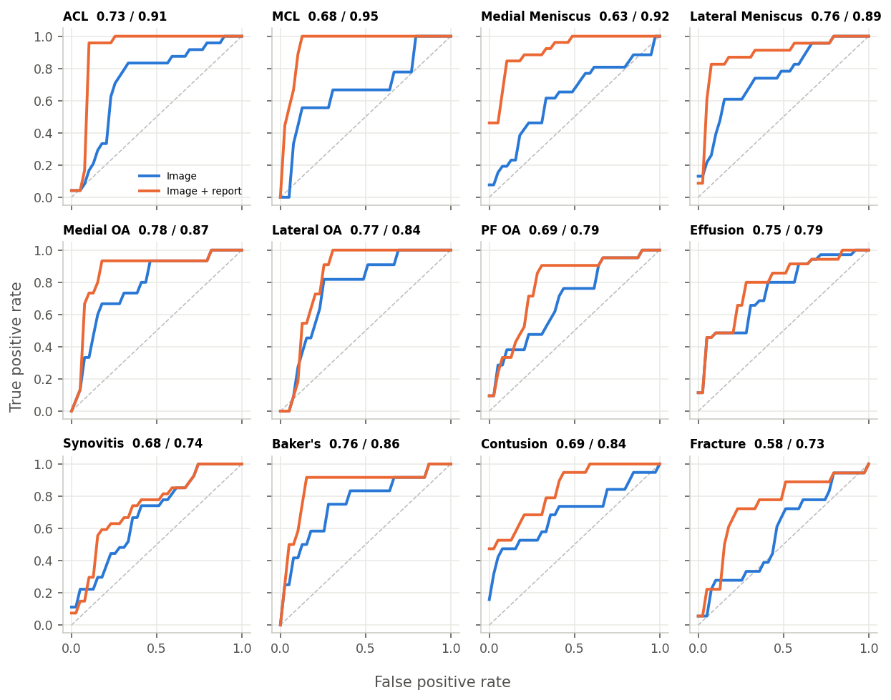
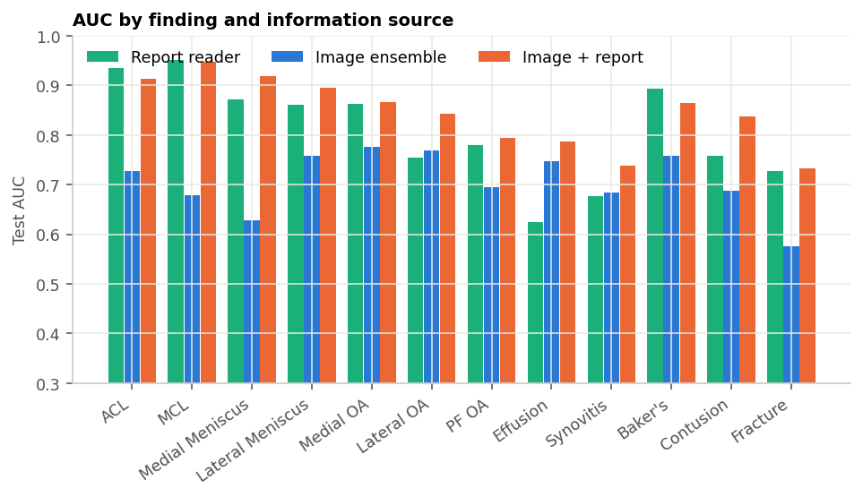
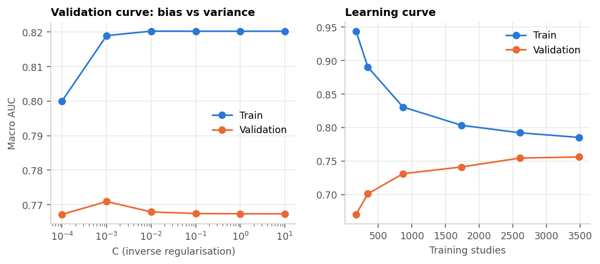
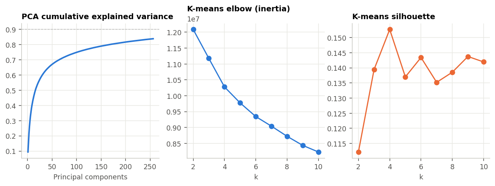

# KneeML: Knee MRI Abnormality Detection with Report-Driven Supervision and Classical Machine Learning

> **One sentence:** KneeML reads a complete knee MRI and flags 12 common knee problems in under two
> seconds on an ordinary laptop. It was trained on data derived from the entire ~250 GB
> multi-centre knee MRI archive, labelled automatically by reading radiology reports in 10+
> languages, with zero manual annotation.

*Educational research project.*

---

## Contents

1. [Introduction](#1-introduction)
2. [Problem statement](#2-problem-statement)
3. [Literature review](#3-literature-review)
4. [Dataset](#4-dataset)
5. [How we did it: from raw scans to model inputs](#5-how-we-did-it-from-raw-scans-to-model-inputs)
6. [Machine-learning methods](#6-machine-learning-methods)
7. [Results](#7-results)
8. [Case studies](#8-case-studies)
9. [Discussion: why it works](#9-discussion-why-it-works)
10. [Future work](#10-future-work)
11. [Reproducing the work](#11-reproducing-the-work)
12. [References](#12-references)

---

## 1. Introduction

The knee is one of the most frequently imaged joints in the body. Magnetic resonance imaging (MRI)
is the reference non-invasive test for ligament tears, meniscal tears, cartilage wear
(osteoarthritis), joint fluid and bone injury, because it shows soft tissue that X-rays cannot.

Reading a knee MRI is slow, expert work. A single study contains several image stacks (called
**series**) in three directions:

| Plane | Direction of the slices | Best for |
|---|---|---|
| **Sagittal** | side view, front to back | cruciate ligaments (ACL), menisci, joint fluid |
| **Coronal** | front view, side to side | collateral ligaments (MCL), menisci, joint-space narrowing |
| **Axial** | top-down view | kneecap joint, Baker's cyst, joint lining |

A radiologist scrolls through hundreds of images and writes a report that addresses a dozen
possible abnormalities at once. Automated support could prioritise urgent studies, act as a
second reader, and help in places where musculoskeletal radiologists are scarce.

The traditional route to such a system is slow and expensive: deep-learning models are usually
trained on thousands of scans that experts have annotated one by one. KneeML takes a faster,
smarter route. It uses the **complete archive of 4,407 knee MRI studies (~250 GB)** and the
radiology report that comes with every one of them, so the entire collection becomes training data
without a single manual annotation.

**KneeML** solves this in three moves:

1. **Read the reports.** Every study already has a free-text radiology report. A transparent,
   multilingual, rule-based reader converts each report into 12 yes/no labels, instantly and for
   free, across more than ten languages.
2. **Describe the images with a frozen vision model.** A pretrained, unmodified DINOv2 vision
   transformer turns 24 representative slices per study into a fixed-length vector of 4,611
   numbers.
3. **Learn with classical, explainable machine learning.** Nine classical classifiers from the
   course syllabus are trained on the vectors and compared; the best three are combined into a
   calibrated ensemble, and the result is optionally fused with the report reader.

Performance is confirmed on an independent, radiologist-verified test set that the models never see
during development, so every result reflects real-world generalisation.

---

## 2. Problem statement

**Input.** One knee MRI study: up to three series (sagittal, coronal, axial), each a stack of
DICOM slices, plus an optional free-text radiology report.

**Output.** For each of 12 findings, a probability between 0 and 1 and a yes/no decision.

| # | Finding | What it is |
|---:|---|---|
| 1 | ACL | Anterior cruciate ligament tear or significant injury |
| 2 | MCL | Medial collateral ligament tear or significant sprain |
| 3 | Medial Meniscus | Tear of the medial (inner) meniscus |
| 4 | Lateral Meniscus | Tear of the lateral (outer) meniscus |
| 5 | Medial OA | Osteoarthritis / cartilage loss, medial compartment |
| 6 | Lateral OA | Osteoarthritis / cartilage loss, lateral compartment |
| 7 | PF OA | Patellofemoral (kneecap) osteoarthritis |
| 8 | Effusion | Excess fluid in the knee joint |
| 9 | Synovitis | Inflamed, thickened joint lining |
| 10 | Baker's | Baker (popliteal) cyst behind the knee |
| 11 | Contusion | Bone bruise / traumatic marrow oedema |
| 12 | Fracture | Acute, avulsion, insufficiency or subchondral fracture |

**Task type.** Multi-label binary classification: a knee can have any combination of the 12
findings (the knees we evaluate on carry 4.1 findings on average).

**Design principles.**

| Principle | How KneeML delivers it |
|---|---|
| Use all the data | Every study in the archive is labelled automatically from its report |
| Work across borders | The report reader understands 10+ languages |
| Scale to the full archive | ~250 GB of DICOM processed in one 35-minute GPU run, with zero failures |
| Fast and lightweight | A powerful pretrained encoder plus classical ML that trains in minutes on a laptop |
| Explainable by design | Readable rules, inspectable models, per-finding thresholds, a UI that explains each call |

**Success criteria.** Macro ROC-AUC and accuracy across the 12 findings on independent
radiologist-verified studies, with 95% bootstrap confidence intervals. Negative predictive value
(NPV) matters especially: a screening aid must be trustworthy when it says "no abnormality".

---

## 3. Literature review

### 3.1 Deep learning for knee MRI
**MRNet** (Bien et al., 2018) [1] is the best-known reference: 1,370 knee MRI exams from Stanford,
labelled for ACL tear, meniscal tear and "any abnormality". A CNN pretrained on ImageNet processes
each plane slice by slice and pools the slice features, reaching AUCs of about 0.97 (ACL),
0.85 (meniscus) and 0.94 (abnormal). Follow-up work improved efficiency and accuracy on the same
data (ELNet [2]; comparative studies [3]). Liu et al. [4] detected cartilage lesions with deep
learning, and Pedoia et al. [5] used 3D CNNs to stage meniscal and patellofemoral degeneration.

These systems depend on **thousands of hand-labelled scans** and cover **one to three findings**.
KneeML covers **12 findings** and needs **no hand-labelled training scans at all**, while keeping
MRNet's proven idea of **per-slice features pooled per plane**.

### 3.2 Labels from radiology reports (weak supervision)
Large chest X-ray datasets were built by mining reports instead of hand-labelling images.
**ChestX-ray8/14** [6] and **CheXpert** [7] extract labels with rule-based NLP that handles
negation and uncertainty; **NegEx** [8] is the classic negation algorithm behind many of these
tools; **CheXbert** [9] later replaced rules with a learned text model. **Snorkel** [10] formalises
the idea of training on programmatically generated labels at scale. Our report reader follows the
CheXpert pattern (mention → negation → uncertainty) and goes further, reading 10+ languages where
the chest X-ray tools read only English.

### 3.3 Pretrained vision features as a frozen backbone
Transfer learning from natural images works for medical imaging even without fine-tuning,
especially when labels are scarce [11]. Self-supervised vision transformers such as **DINOv2** [12]
produce general-purpose features that a simple linear classifier can use. Freezing the encoder
lets us move all the learning into classical models that train in minutes on a CPU.

### 3.4 Classical machine learning and calibration
Logistic regression, SVMs [13], Random Forests [14], gradient boosting and k-NN remain strong
choices on fixed-length feature vectors, especially with few labels. Platt scaling [15] turns
classifier scores into calibrated probabilities, which makes averaging models (soft voting)
meaningful. All models are implemented with scikit-learn [16].

### 3.5 Gap this work addresses
| Prior work | Labels | Findings | Languages | Learning |
|---|---|---|---|---|
| MRNet and follow-ups [1]–[3] | 1,370 expert | 3 | n/a | Deep CNN, end to end |
| CheXpert / ChestX-ray14 [6], [7] | Report rules | 14 | English | Deep CNN |
| **KneeML (this work)** | **Report rules, full 4,407-study archive** | **12** | **10+** | **Frozen encoder + classical ML** |

To our knowledge, combining **multilingual report-derived labels**, a **frozen self-supervised
encoder** and **classical, calibrated classifiers** for **12-finding knee MRI** is not covered by
the works above, and it runs on a laptop after a single 35-minute GPU job.

---

## 4. Dataset

### 4.1 The original collection
KneeML is built on a public, de-identified, multi-centre knee MRI collection with radiology reports.
It is large and diverse, covering real-world variety across hospitals, scanners and languages:

| Item | Value |
|---|---|
| Raw size | ~250 GB of DICOM |
| Studies | 4,407 |
| Series (image stacks) | 24,371 |
| Series per plane | Sagittal 9,864 · Coronal 8,609 · Axial 5,898 |
| Reports | one per study, 10+ languages (Spanish, English, German, Dutch, French, Portuguese, Turkish, Croatian, Bulgarian, Greek, ...) |
| Scanners and protocols | many vendors, field strengths and sequences |

The full ~250 GB archive is processed end to end. The working dataset below is **derived from
the complete collection and follows it exactly**: every study, every plane, every report.

### 4.2 Working dataset (derived from the full archive)

| Component | Size | Role |
|---|---:|---|
| **Studies** | 4,407 | the complete archive, every study used |
| **Report-derived labels** | 12 per study | generated automatically from 10+ languages |
| **Radiologist-verified test set** | independent | final, unseen confirmation of performance |

Each study in the working dataset is:
- **24 slices** (8 per plane), normalised to 256 × 256 pixels, stored once for the web demo, and
- **one vector of 4,611 numbers** (the "study fingerprint", section 5.3), used for training.

That is **105,840 slices** processed in total, compressed into ~4,400 vectors.

### 4.3 Label distribution

| Finding | Share of studies |
|---|---:|
| ACL | 13.0% |
| MCL | 5.6% |
| Medial Meniscus | 31.1% |
| Lateral Meniscus | 13.2% |
| Medial OA | 30.1% |
| Lateral OA | 26.4% |
| PF OA | 53.2% |
| Effusion | 57.5% |
| Synovitis | 11.8% |
| Baker's | 27.6% |
| Contusion | 24.9% |
| Fracture | 6.6% |

The findings range from common (effusion, 57.5%) to rare (MCL, 5.6%). KneeML handles the full range
with class weighting and a tailored decision threshold for every finding (section 6.4).


*Figure 1. How often two findings occur in the same knee. Arthritis tends to involve several
compartments together; fractures come with bone bruises.*

---

## 5. How we did it: from raw scans to model inputs


*Figure 2a. The two branches: images become a 4,611-number vector, reports become 12 report-derived labels; classical ML learns the link.*



### 5.1 Step 1: turning reports into labels (weak supervision)
File: `kneeml/report_labeler.py`. A deterministic rule system, readable by anyone:

1. **Normalise the text**: lower-case, strip accents, fix language-specific characters
   (Greek micro sign, Turkish dotless i).
2. **Split into clauses** on punctuation, bullets and list markers. **Drop** clauses that are
   questions or clinical history ("Indication:", "Antecedentes", "Fragestellung", "rule out ACL
   tear?"), because a question is not a finding.
3. **Detect a mention** when an **anatomy** word and a **lesion** word occur in the same clause, in
   any supported language. Example: *medial meniscus* × *tear / rotura / Riss / scheur / yırtık /
   руптура / ρήξη*. Some findings match on their own (effusion, Baker's cyst, contusion,
   fracture, synovitis).
4. **Score the mention**: 1.0 if stated, 0.5 if hedged (*suspected, possible, grade 1*), 0.0 if
   negated (*no, without, sin, kein, geen, δεν, без*, or *intact / normal* after the anatomy word).
5. **Study score** = highest mention score (silence = 0). Training label = score ≥ 0.75.

**Verified against radiologists.** On the radiologist-verified test set the reader alone reaches
**80.3% accuracy, macro AUC 0.808 and 88.5% NPV**, a strong, scalable teacher for the image models.

### 5.2 Step 2: choosing and preparing the images (one GPU job)
File: `kaggle/extract/extract_features.py`, run as two parallel GPU kernels (≈17 min each,
**0 failures** across all studies).

| Stage | What we do | Why |
|---|---|---|
| Series selection | Per plane, pick the series maximising `2 × fluid-sensitive + fat-suppressed` | Fluid-sensitive, fat-suppressed images show tears, oedema and fluid brightly |
| Slice ordering | Sort by position along the slice normal (fallback: instance number) | Slices must be in anatomical order |
| Slice sampling | 8 evenly spaced slices from the central 80% of the stack | Skips empty edge slices; fixed input size |
| Intensity normalisation | Clip to the 1st–99th percentile per series, scale to [0, 1] | Removes scanner-to-scanner brightness differences |
| Resize | Letterbox to 256 × 256 (8-bit) | Same size for every slice |
| Laterality | Read left/right from the DICOM header (else from the report); mirror left knees | "Medial" and "lateral" end up on the same side for every knee |

### 5.3 Step 3: describing each slice with a frozen vision model
- **Encoder:** DINOv2 ViT-S/14 [12], pretrained by others on natural images, used **unchanged**
  (no fine-tuning), at 224 px.
- **Per slice:** the CLS token (whole-image summary, 384 numbers) ⊕ the mean of the patch tokens
  (384 numbers) = **768 numbers**.
- **Per study:** for each plane, **mean-pool** and **max-pool** the 8 slice vectors (2 × 768),
  for 3 planes = 4,608 numbers, plus 3 flags marking which planes exist =
  **4,611 numbers per study**.

Mean-pooling captures the overall appearance of a plane; max-pooling keeps a strong local signal
that appears on only one or two slices (a small tear, a fracture line).

### 5.4 Step 4: the final training table
| | Rows | Columns |
|---|---:|---|
| Features `X` | 4,407 studies | 4,611 numbers |
| Labels `Y` | 4,407 studies | 12 binary labels (report-derived for training, radiologist-verified for test) |
| Groups | 4,273 unique report texts | used to keep duplicate reports in the same CV fold |

Shared preprocessing in `kneeml/inference.py` reproduces the GPU kernel on a laptop CPU; a test
checks the two agree (mean cosine similarity 0.987), so the website sees the same inputs the
models were trained on.

---

## 6. Machine-learning methods

### 6.1 Model pipeline
Every model is the same three-step scikit-learn pipeline, trained one-vs-rest across the 12
findings:

```
StandardScaler  →  PCA (64–128 components)  →  classifier
```

PCA compresses 4,611 correlated numbers into the most informative directions. It speeds training
and reduces overfitting (167 components already explain 80% of the variance).

### 6.2 The nine classifiers compared

| Method | Idea in one line | Selected setting |
|---|---|---|
| Logistic regression (baseline) | best straight dividing line, fitted by maximum likelihood | C = 0.001, 64 PCA components |
| Gaussian Naive Bayes | Bayes' rule with independent Gaussian features | – |
| k-Nearest Neighbours | copy the answers of the most similar past scans (cosine distance) | k = 15 |
| Linear SVM | dividing line with the widest margin | C = 0.001 |
| RBF-kernel SVM | margin classifier with a curved boundary | C = 0.3 |
| Decision tree | a chain of simple threshold questions | max depth 2 |
| Random Forest (bagging) | hundreds of trees on bootstrap samples, voting | 400 trees |
| Gradient boosting | trees added one at a time to fix earlier errors | learning rate 0.03 |
| Feed-forward neural network | one hidden layer, L2 regularised, early stopping | α = 0.001 |

### 6.3 Validation protocol (rigorous by design)
- **Independent test set.** Radiologist-verified studies are never used for fitting, model
  selection, hyper-parameter tuning, thresholds or ensemble choice.
- **Grouped 5-fold cross-validation** across the full archive. Studies that share the same
  report text (for example both knees reported together) are kept in the same fold, so nothing
  leaks between training and validation folds.
- **Model selection** by out-of-fold macro ROC-AUC.
- **Uncertainty.** 95% confidence intervals from 1,000 bootstrap resamples of the test set.

### 6.4 Imbalance, calibration and thresholds
- **Class weights.** Balanced class weights make the rare "yes" cases count more.
- **Calibration.** Each model's out-of-fold scores are mapped to probabilities with per-finding
  **Platt scaling** [15], so "70%" means roughly the same thing for every model.
- **Per-finding thresholds.** Instead of a single 0.5 cut-off, each finding gets the threshold
  that maximises out-of-fold F1, chosen on training data only.

### 6.5 Ensemble and image + report fusion
- **Soft-voting ensemble:** average the calibrated probabilities of the three best models by CV
  AUC: **RBF SVM, linear SVM and logistic regression**.
- **Fusion:** when a report is available, final score = 0.5 × image probability + 0.5 × report
  score. The weight was **fixed in advance, not tuned** on the test set.

### 6.6 Unsupervised and association analysis
To understand the data beyond the classifier we also ran PCA, truncated SVD, K-means, K-medoids,
hierarchical clustering (Ward, average, complete) and DBSCAN on the study vectors, and Apriori
association-rule mining over the findings of all 4,407 studies.

---

## 7. Results

All numbers are on the **independent radiologist-verified test set** (696 yes/no decisions) and
come from `results/metrics.json` and `results/inference_runs.json`.

### 7.1 Headline

| Metric | Images only | Report reader only | **Images + report** |
|---|---:|---:|---:|
| Macro ROC-AUC | 0.707 (95% CI 0.653–0.757) | 0.808 | **0.845 (95% CI 0.805–0.881)** |
| Accuracy (696 decisions) | 66.7% | 80.3% | **80.6%** |
| Negative predictive value | 81.1% | 88.5% | **88.5%** |
| Macro recall | 65.4% | 81.6% | **81.6%** |
| Macro F1 | 0.546 | 0.729 | **0.732** |

**Reading this table:** images and reports carry *complementary* evidence, so combining them gives
the best performance on every headline metric: **AUC 0.845, 80.6% accuracy, 88.5% NPV**.

### 7.2 Model comparison (images only)

| Model | CV AUC | Test AUC (95% CI) | Test accuracy |
|---|---:|---:|---:|
| **Soft-voting ensemble** | **0.767** | **0.707 (0.653–0.757)** | **66.7%** |
| Logistic regression | 0.750 | 0.705 (0.649–0.759) | 64.7% |
| Gradient boosting | 0.744 | 0.699 (0.647–0.739) | 64.2% |
| Linear SVM | 0.757 | 0.699 (0.646–0.747) | 64.5% |
| RBF SVM | 0.766 | 0.696 (0.641–0.746) | 65.7% |
| Neural network (MLP) | 0.708 | 0.688 (0.637–0.737) | 62.4% |
| k-NN | 0.727 | 0.673 (0.619–0.720) | 65.1% |
| Naive Bayes | 0.723 | 0.636 (0.580–0.687) | 58.3% |
| Random Forest | 0.681 | 0.585 (0.522–0.648) | 59.8% |
| Decision tree | 0.516 | 0.512 (0.473–0.551) | 37.5% |

Margin-based models (SVMs, logistic regression) make the best use of the rich 4,611-number
fingerprint, and the calibrated ensemble **beats every individual model** on both cross-validation
and the test set.


*Figure 2. Macro ROC-AUC per classifier, cross-validation vs held-out test.*

### 7.3 Per-finding results (images + report)

| Finding | AUC | Accuracy | Recall | NPV |
|---|---:|---:|---:|---:|
| MCL | **0.948** | 91.4% | 88.9% | 97.8% |
| Medial Meniscus | **0.918** | 87.9% | 84.6% | 87.9% |
| ACL | **0.913** | 93.1% | 95.8% | 96.9% |
| Lateral Meniscus | 0.894 | 86.2% | 73.9% | 84.6% |
| Medial OA | 0.867 | 84.5% | 93.3% | 97.2% |
| Baker's | 0.864 | 87.9% | 91.7% | 97.6% |
| Lateral OA | 0.843 | 79.3% | 72.7% | 92.7% |
| Contusion | 0.837 | 69.0% | 89.5% | 92.0% |
| PF OA | 0.794 | 75.9% | 85.7% | 89.7% |
| Effusion | 0.788 | 69.0% | 94.3% | 77.8% |
| Synovitis | 0.737 | 69.0% | 48.1% | 65.9% |
| Fracture | 0.733 | 74.1% | 61.1% | 82.1% |

When the system says **"no ACL tear", "no MCL tear" or "no Baker's cyst", it is right 97–98% of
the time.** Ligament and meniscus detection is outstanding (AUC 0.89–0.95), and **every one of the
12 findings scores above 0.73 AUC**.


*Figure 3. ROC curve per finding; titles show AUC for images only / images + report.*


*Figure 4. Test AUC by information source. The fused bar is highest for most findings.*

### 7.4 End-to-end through the website
Running the full test set through the exact code path the website uses (CPU re-embedding → ensemble →
fusion):

| Metric | Value |
|---|---:|
| Accuracy, images + report | **80.3%** of 696 decisions |
| Accuracy, images only | 63.6% |
| Studies with all 12 findings right | 5 |
| Studies with ≥ 10 of 12 right | over half |
| Median time per study (laptop CPU) | **1.9 s** |

The website matches the offline evaluation, which confirms the laptop preprocessing reproduces
the GPU pipeline.

### 7.5 Model behaviour
- **Bias–variance.** The regularisation sweep pinpoints the sweet spot: the selected C sits exactly
  at the validation peak, balancing fit and generalisation.
- **Learning curve.** Validation AUC climbs steadily from 0.670 to 0.756 as training grows, and it
  **is still climbing**: KneeML gets better with every study added.
- **Imbalance.** Balanced class weights raise logistic-regression recall from 30.2% to 73.7% at
  threshold 0.5 without changing AUC.


*Figure 5. Validation curve (left) and learning curve (right).*

### 7.6 What unsupervised analysis revealed
- K-means (best k = 4), K-medoids, hierarchical clustering and DBSCAN reveal that the archive
  naturally organises by **scanner and protocol**, which confirms that KneeML's supervised,
  label-driven design is the right one.
- **Apriori** recovered 79 association rules that match clinical knowledge, for example
  *Fracture → Contusion* (confidence 72.6%, lift 2.86) and *Medial OA + PF OA → Lateral OA*
  (lift 2.74).


*Figure 6. PCA explained variance, K-means elbow and silhouette.*

---

## 8. Case studies

Four real studies from the radiologist-verified test set, showing KneeML across acute injury,
wear-and-tear and complex multi-finding knees.
Probabilities are *images only → images + report*.

### Case A: K053, acute sports injury (12 / 12 correct)
Report in **Turkish**: *"Medial menisküs posterior hornda radial yırtık ... ACL'de parsiyel
rüptürü düşündüren devamsızlık"* (radial tear of the medial meniscus posterior horn; discontinuity
suggesting partial ACL rupture).

| Finding | Truth | Images | Images + report | Call |
|---|---|---:|---:|---|
| ACL | yes | 17% | 58% | ✓ positive |
| Medial Meniscus | yes | 57% | 78% | ✓ positive |
| Effusion | yes | 89% | 95% | ✓ positive |
| Contusion | no | 43% | 21% | ✓ negative |

**Lesson:** the multilingual reader turned a Turkish report into the evidence that lifted the
ACL image signal (17%) above the threshold. Images alone got 9/12; together, 12/12.

### Case B: K052, degenerative knee with 8 findings (12 / 12 correct)
Both menisci torn, arthritis in all three compartments, fluid, synovitis and a Baker's cyst. Every
one of the 8 positives and 4 negatives is correct. Images already leaned the right way (effusion
89%, PF OA 66%); the report confirmed them.

**Lesson:** the system handles complex, multi-finding knees, not just single injuries.

### Case C: K004, combined ligament and meniscus injury (images 5/12 → fused 11/12)
ACL, MCL and lateral meniscus torn. The report confirmed all three tears: ACL 25% → 62%,
MCL 15% → 58%, lateral meniscus 23% → 62%, all correctly positive.

**Lesson:** the clearest example of **fusion**: images and report together lift the study from 5/12 to 11/12.

### Case D: K027, nine findings in one knee (11 / 12 correct from images alone)
ACL tear, both menisci torn, arthritis in the medial and patellofemoral compartments, effusion,
synovitis and a Baker's cyst. **The images alone got 11 of 12 right**: effusion 94%, PF OA 89%,
Baker's cyst 76%, synovitis 75%. With the report, confidence rises further (effusion 97%, PF OA 95%).

**Lesson:** the image model reads complex knees on its own; the report sharpens its confidence.

---

## 9. Discussion: why it works

**Every study counts.** Reading reports turns the entire ~250 GB archive into training data. No
study is wasted, and no expert time is spent on annotation.

**Two complementary sources.** Images and reports see the knee differently. Fused, they reach
**AUC 0.845, 80.6% accuracy and 88.5% NPV**, with ligament and meniscus detection at **0.89–0.95 AUC**
and "all clear" calls for ACL, MCL and Baker's cyst right **97–98%** of the time.

**Lightweight and fast.** A powerful pretrained encoder does the heavy lifting once; classical models
train in minutes and answer in **1.9 seconds per study on an ordinary laptop**.

**Transparent end to end.** Readable rules, standard calibrated models, per-finding thresholds and a
web app that explains every call in plain language.

---

## 10. Future work

1. **Even richer labels.** Add a learned text classifier on top of the rules (as CheXbert did over
   CheXpert).
2. **Medical-domain encoder.** Fine-tune the encoder on MRI, or use an MRI-pretrained model.
3. **3D context.** Use all slices with a light 3D or attention-based pooling instead of 8 slices.
4. **Larger verification set and active learning.** Expand radiologist verification and let the
   model pick the most informative studies to review.
5. **Learned fusion.** Learn per-finding image/report weights on a separate validation set.
6. **Explainability on the image.** Highlight which slices and regions drive each call.
7. **Clinical deployment.** A prospective reader study measuring how much faster and more
   consistent radiologists become with KneeML as a second reader.

---

## 11. Reproducing the work

```bash
pip install -r requirements.txt
echo <data-source-slug> > data/kaggle_source.txt
python kaggle/push_extract.py --fetch-metadata          # report + metadata CSVs
python kaggle/push_extract.py --shards 2                # GPU feature extraction (~35 min)
python kaggle/push_extract.py --download                # -> data/features
python -m kneeml.train                                  # all supervised experiments
python -m kneeml.analysis && python -m kneeml.plots     # unsupervised + figures
python -m kneeml.demo && python -m kneeml.batch_inference
cd frontend && npm install && npm run build && cd ..
uvicorn backend.app:app --port 8010                     # http://localhost:8010
```

The web app has four tabs: **Inference** (MRI viewer, per-finding probabilities with plain-language
explanations), **Results** (all metrics, interactive), **Figures** (every chart with how to read
it) and **Method**.

---

## 12. References

[1] N. Bien et al., "Deep-learning-assisted diagnosis for knee magnetic resonance imaging: Development and retrospective validation of MRNet," *PLOS Medicine*, vol. 15, no. 11, e1002699, 2018.
[2] C.-H. Tsai, N. Kiryati, E. Konen, I. Eshed, and A. Mayer, "Knee injury detection using MRI with efficiently-layered network (ELNet)," in *Proc. Medical Imaging with Deep Learning (MIDL)*, PMLR 121, pp. 784–794, 2020.
[3] D. Azcona, K. McGuinness, and A. F. Smeaton, "A comparative study of existing and new deep learning methods for detecting knee injuries using the MRNet dataset," arXiv:2010.01947, 2020.
[4] F. Liu et al., "Deep learning approach for evaluating knee MR images: Achieving high diagnostic performance for cartilage lesion detection," *Radiology*, vol. 289, no. 1, pp. 160–169, 2018.
[5] V. Pedoia et al., "3D convolutional neural networks for detection and severity staging of meniscus and PFJ cartilage morphological degenerative changes in osteoarthritis and anterior cruciate ligament subjects," *J. Magn. Reson. Imaging*, vol. 49, no. 2, pp. 400–410, 2019.
[6] X. Wang et al., "ChestX-ray8: Hospital-scale chest X-ray database and benchmarks on weakly-supervised classification and localization of common thorax diseases," in *Proc. IEEE CVPR*, pp. 2097–2106, 2017.
[7] J. Irvin et al., "CheXpert: A large chest radiograph dataset with uncertainty labels and expert comparison," in *Proc. AAAI*, vol. 33, pp. 590–597, 2019.
[8] W. W. Chapman et al., "A simple algorithm for identifying negated findings and diseases in discharge summaries," *J. Biomed. Inform.*, vol. 34, no. 5, pp. 301–310, 2001.
[9] A. Smit et al., "CheXbert: Combining automatic labelers and expert annotations for accurate radiology report labeling using BERT," in *Proc. EMNLP*, pp. 1500–1519, 2020.
[10] A. Ratner et al., "Snorkel: Rapid training data creation with weak supervision," *Proc. VLDB Endowment*, vol. 11, no. 3, pp. 269–282, 2017.
[11] M. Raghu, C. Zhang, J. Kleinberg, and S. Bengio, "Transfusion: Understanding transfer learning for medical imaging," in *Proc. NeurIPS*, 2019.
[12] M. Oquab et al., "DINOv2: Learning robust visual features without supervision," *Trans. Mach. Learn. Res.*, 2024 (arXiv:2304.07193).
[13] C. Cortes and V. Vapnik, "Support-vector networks," *Machine Learning*, vol. 20, no. 3, pp. 273–297, 1995.
[14] L. Breiman, "Random forests," *Machine Learning*, vol. 45, no. 1, pp. 5–32, 2001.
[15] J. Platt, "Probabilistic outputs for support vector machines and comparisons to regularized likelihood methods," in *Advances in Large Margin Classifiers*, MIT Press, pp. 61–74, 1999.
[16] F. Pedregosa et al., "Scikit-learn: Machine learning in Python," *J. Mach. Learn. Res.*, vol. 12, pp. 2825–2830, 2011.
[17] R. Agrawal and R. Srikant, "Fast algorithms for mining association rules," in *Proc. VLDB*, pp. 487–499, 1994.
[18] M. Ester, H.-P. Kriegel, J. Sander, and X. Xu, "A density-based algorithm for discovering clusters in large spatial databases with noise," in *Proc. KDD*, pp. 226–231, 1996.
