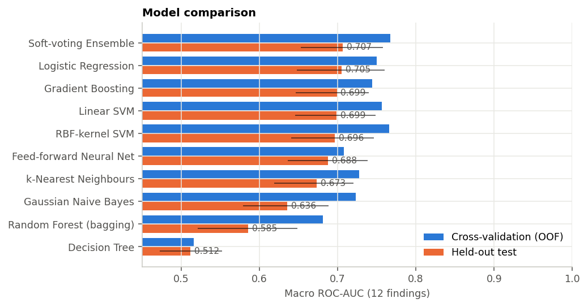
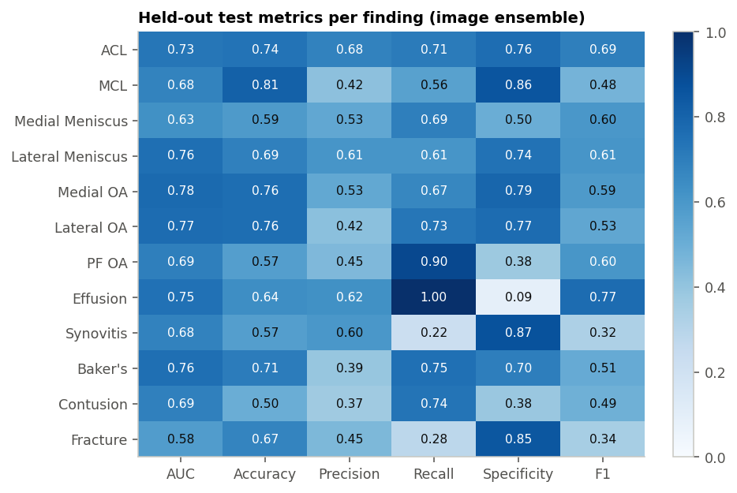
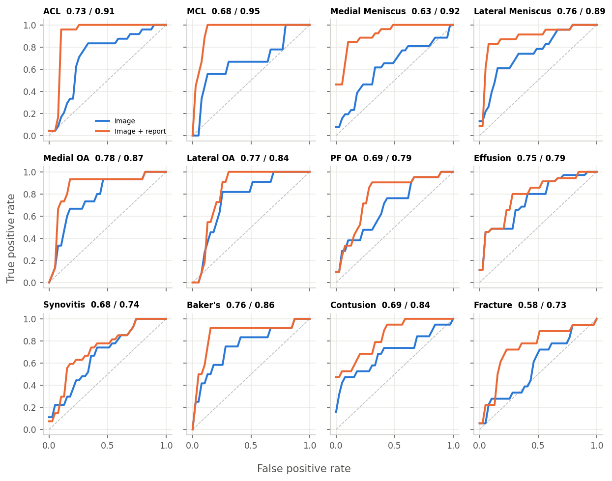
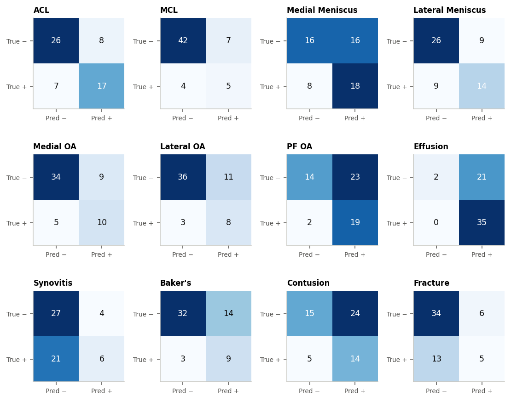
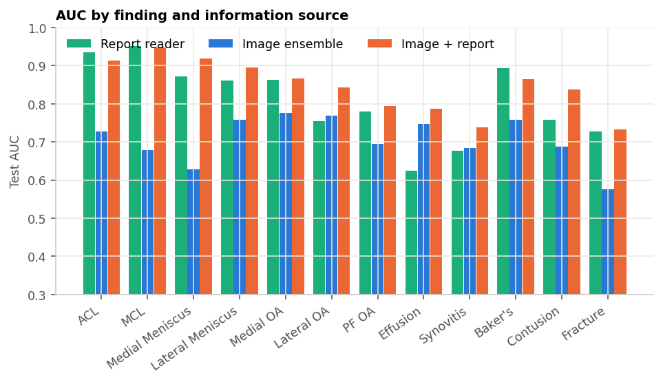
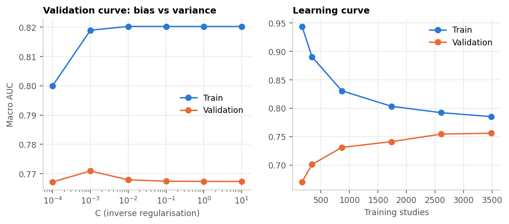
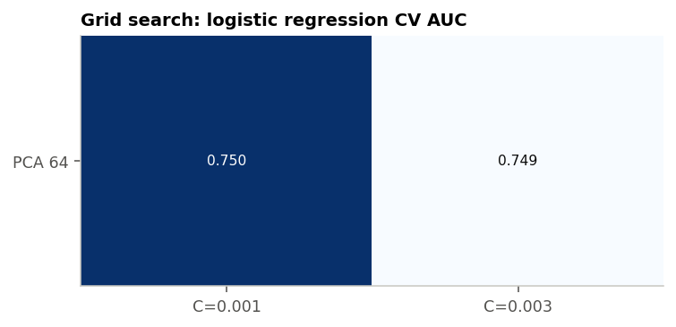
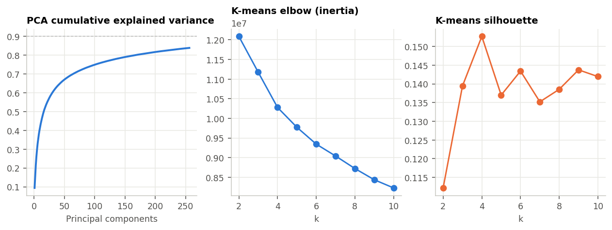
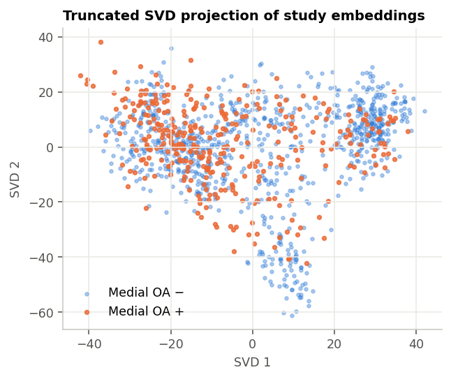
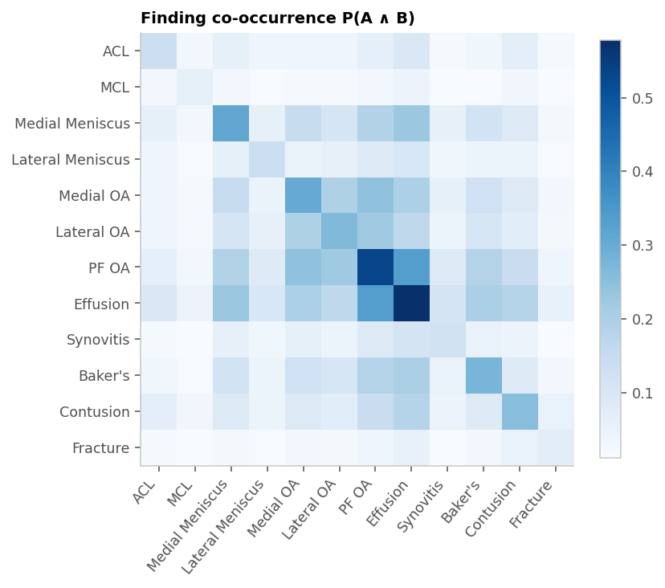

# KneeML — Technical Report

Multi-label detection of 12 knee abnormalities from MRI using a frozen pretrained vision encoder
and classical machine-learning heads. All numbers in this document are generated by
`python -m kneeml.docs` from `results/metrics.json` and `results/unsupervised.json`.

## 1. Problem

Given one knee MRI study (several series in sagittal, coronal and axial planes), predict the
probability of each of 12 findings. It is a **multi-label binary classification** problem: a knee
can have any combination of findings.

| Finding | Definition | Train prevalence (weak) | Test prevalence (radiologist) |
|---|---|---:|---:|
| ACL | Anterior cruciate ligament tear or significant injury | 13.0% | 41.4% |
| MCL | Medial collateral ligament tear or significant sprain | 5.6% | 15.5% |
| Medial Meniscus | Tear of the medial meniscus | 31.1% | 44.8% |
| Lateral Meniscus | Tear of the lateral meniscus | 13.2% | 39.7% |
| Medial OA | Osteoarthritis / cartilage loss, medial compartment | 30.1% | 25.9% |
| Lateral OA | Osteoarthritis / cartilage loss, lateral compartment | 26.4% | 19.0% |
| PF OA | Patellofemoral osteoarthritis / chondropathy | 53.2% | 36.2% |
| Effusion | Knee joint effusion | 57.5% | 60.3% |
| Synovitis | Synovitis or synovial thickening | 11.8% | 46.6% |
| Baker's | Baker (popliteal) cyst | 27.6% | 20.7% |
| Contusion | Bone contusion / traumatic marrow oedema | 24.9% | 32.8% |
| Fracture | Acute, avulsion, insufficiency or subchondral fracture | 6.6% | 31.0% |

## 2. Data

| Item | Value |
|---|---|
| Studies | 4,407 (all with images: 4,407) |
| Series | 24,371 — Sagittal 9,864, Coronal 8,609, Axial 5,898 |
| Free-text reports | one per study, 10+ languages (Spanish, English, German, Dutch, French, Portuguese, Turkish, Croatian, Bulgarian, Greek, …) |
| Unique report texts (CV groups) | 4,273 |
| Radiologist-labelled studies | 58 → **held-out test set** |
| Training pool | 4,349 studies with report-derived labels |

Source: a public, de-identified knee MRI collection with radiology reports (RSNA). Only 58 studies
carry expert labels, so the remaining studies are labelled automatically from their reports
(weak supervision).

## 3. Method

### 3.1 Weak labels from reports (rule-based reader)
`kneeml/report_labeler.py` is a deterministic, multilingual rule system, an explicit
hand-written hypothesis in the sense of concept learning:

1. Normalise text (lower-case, strip accents, fix Greek micro-sign and Turkish dotless-i).
2. Split into clauses on sentence punctuation, bullets and list markers; drop clauses that are
   questions or clinical history ("Indication:", "Antecedentes", "Fragestellung", …).
3. A finding is mentioned when an **anatomy** pattern and a **lesion** pattern co-occur in a
   clause (e.g. *medial meniscus* × *tear/rotura/Riss/scheur/yırtık/руптура/ρήξη*), or when a
   standalone pattern matches (effusion, Baker's cyst, contusion, fracture, synovitis).
4. Each mention is scored 1.0 (asserted), 0.5 (hedged: *suspected, possible, R/O, grade 1*) or
   0.0 (negated: *no, without, sin, kein, geen, δεν, без*, or *intact / normal* after the anatomy).
5. Study score = max over mentions; silence = 0. Training label = score ≥ 0.75.

Agreement with radiologist labels on the test set: **macro AUC 0.808**, macro F1
0.729, accuracy 80.3%. The reader is imperfect by design, and the
expert labels are image-based (some findings are visible but not written in the report), so
this noise bounds what an image model trained on it can reach.

### 3.2 Image representation (one-off GPU job)
`kaggle/extract/extract_features.py` runs as a Kaggle GPU kernel (2 shards, ≈17 min each, 0 failures):

1. **Series selection** per plane: maximise `2·fluid_sensitive + fat_suppressed`.
2. **Slice ordering** by projecting `ImagePositionPatient` on the slice normal (fallback
   `InstanceNumber`); **8 slices** evenly spaced over the central 80% of the series.
3. **Normalisation**: per-series 1st–99th percentile clip → [0,1] → letterbox to 256×256 uint8.
4. **Laterality**: from DICOM header, else report keywords; left knees are mirrored (coronal,
   axial) and the sagittal sweep reversed, so medial/lateral are consistent.
5. **Encoder**: frozen DINOv2 ViT-S/14 at 224 px; per slice = CLS token ⊕ mean patch token
   (768-d). No fine-tuning: the deep network is used purely as a feature extractor.

Study vector: for each plane, mean- and max-pool over the 8 slices (2×768) → 3 planes → 4,608-d,
plus 3 plane-present flags = **4,611 features**.

### 3.3 Classical models
Each model is `StandardScaler → PCA → estimator`, one-vs-rest across the 12 labels:

| Syllabus unit | Model |
|---|---|
| I | Logistic regression (L2, MLE) |
| III | Gaussian Naive Bayes |
| III | k-Nearest Neighbours (cosine, distance-weighted) |
| III | Linear SVM, RBF-kernel SVM |
| II | Decision tree |
| II / III | Random Forest (bagging, balanced bootstrap weights) |
| III | Histogram gradient boosting |
| VI | Feed-forward neural network (MLP, 1 hidden layer, early stopping) |
| III | Soft-voting ensemble of the top-3 models |

### 3.4 Evaluation protocol
* **Test set**: the 58 radiologist-labelled studies, never used for fitting,
  model selection, tuning, thresholds or ensemble choice.
* **Validation**: 5-fold `GroupKFold` on the training pool, grouped by report text so bilateral
  studies sharing a report never straddle folds. Model selection uses out-of-fold (OOF) macro AUC
  against the weak labels.
* **Calibration**: each model's OOF scores are mapped to probabilities with per-label Platt scaling.
* **Thresholds**: per finding, the threshold maximising OOF F1.
* **Uncertainty**: 95% confidence intervals for test macro AUC from 1,000 bootstrap resamples.

## 4. Results

### 4.1 Headline (held-out test, 58 studies, 12 findings)

| Metric | Image ensemble | Image + report fusion |
|---|---:|---:|
| Macro ROC-AUC | **0.707** (95% CI 0.653–0.757) | **0.845** (95% CI 0.805–0.881) |
| Micro ROC-AUC | 0.688 | 0.821 |
| Accuracy (all label decisions) | 66.7% | 80.6% |
| Macro specificity | 64.1% | 78.7% |
| Macro NPV | 81.1% | 88.5% |
| Macro recall | 65.4% | 81.6% |
| Macro precision | 50.6% | 68.6% |
| Macro F1 | 0.546 | 0.732 |

Ensemble members (chosen by CV AUC): RBF-kernel SVM, Linear SVM, Logistic Regression. Improvement of the ensemble over the
logistic-regression baseline on the test set: **+0.002 AUC**.



### 4.2 Model comparison

| Model | Selected hyper-parameters | CV AUC (OOF) | Test AUC (95% CI) | Test F1 | Test accuracy |
|---|---|---:|---:|---:|---:|
| Soft-voting Ensemble | `{"members": ["rbf_svm", "linear_svm", "logreg"]}` | 0.767 | 0.707 (0.653–0.757) | 0.546 | 66.7% |
| Logistic Regression | `{"C": 0.001, "components": 64}` | 0.750 | 0.705 (0.649–0.759) | 0.534 | 64.7% |
| Gradient Boosting | `{"lr": 0.03}` | 0.744 | 0.699 (0.647–0.739) | 0.536 | 64.2% |
| Linear SVM | `{"C": 0.001}` | 0.757 | 0.699 (0.646–0.747) | 0.528 | 64.5% |
| RBF-kernel SVM | `{"C": 0.3}` | 0.766 | 0.696 (0.641–0.746) | 0.532 | 65.7% |
| Feed-forward Neural Net | `{"alpha": 0.001}` | 0.708 | 0.688 (0.637–0.737) | 0.518 | 62.4% |
| k-Nearest Neighbours | `{"k": 15}` | 0.727 | 0.673 (0.619–0.720) | 0.484 | 65.1% |
| Gaussian Naive Bayes | `{}` | 0.723 | 0.636 (0.580–0.687) | 0.466 | 58.3% |
| Random Forest (bagging) | `{"n_estimators": 400}` | 0.681 | 0.585 (0.522–0.648) | 0.480 | 59.8% |
| Decision Tree | `{"max_depth": 2}` | 0.516 | 0.512 (0.473–0.551) | 0.485 | 37.5% |

CV AUC is measured against report-derived labels, test AUC against radiologist labels; the two
are not directly comparable, and with 58 test studies the confidence intervals overlap.

### 4.3 Per-finding results — image ensemble

| Finding | Pos | AUC | Acc | Prec | Recall | Spec | NPV | F1 |
|---|---:|---:|---:|---:|---:|---:|---:|---:|
| ACL | 24 | 0.727 | 0.741 | 0.680 | 0.708 | 0.765 | 0.788 | 0.694 |
| MCL | 9 | 0.678 | 0.810 | 0.417 | 0.556 | 0.857 | 0.913 | 0.476 |
| Medial Meniscus | 26 | 0.627 | 0.586 | 0.529 | 0.692 | 0.500 | 0.667 | 0.600 |
| Lateral Meniscus | 23 | 0.758 | 0.690 | 0.609 | 0.609 | 0.743 | 0.743 | 0.609 |
| Medial OA | 15 | 0.777 | 0.759 | 0.526 | 0.667 | 0.791 | 0.872 | 0.588 |
| Lateral OA | 11 | 0.768 | 0.759 | 0.421 | 0.727 | 0.766 | 0.923 | 0.533 |
| PF OA | 21 | 0.695 | 0.569 | 0.452 | 0.905 | 0.378 | 0.875 | 0.603 |
| Effusion | 35 | 0.747 | 0.638 | 0.625 | 1.000 | 0.087 | 1.000 | 0.769 |
| Synovitis | 27 | 0.683 | 0.569 | 0.600 | 0.222 | 0.871 | 0.562 | 0.324 |
| Baker's | 12 | 0.757 | 0.707 | 0.391 | 0.750 | 0.696 | 0.914 | 0.514 |
| Contusion | 19 | 0.688 | 0.500 | 0.368 | 0.737 | 0.385 | 0.750 | 0.491 |
| Fracture | 18 | 0.576 | 0.672 | 0.455 | 0.278 | 0.850 | 0.723 | 0.345 |
| **Macro mean** | | **0.707** | **0.667** | **0.506** | **0.654** | **0.641** | **0.811** | **0.546** |



### 4.4 Per-finding results — image + report fusion

Fusion = 0.5 × image probability + 0.5 × report-reader score (weight fixed a priori, not tuned).

| Finding | Pos | AUC | Acc | Prec | Recall | Spec | NPV | F1 |
|---|---:|---:|---:|---:|---:|---:|---:|---:|
| ACL | 24 | 0.913 | 0.931 | 0.885 | 0.958 | 0.912 | 0.969 | 0.920 |
| MCL | 9 | 0.948 | 0.914 | 0.667 | 0.889 | 0.918 | 0.978 | 0.762 |
| Medial Meniscus | 26 | 0.918 | 0.879 | 0.880 | 0.846 | 0.906 | 0.879 | 0.863 |
| Lateral Meniscus | 23 | 0.894 | 0.862 | 0.895 | 0.739 | 0.943 | 0.846 | 0.810 |
| Medial OA | 15 | 0.867 | 0.845 | 0.636 | 0.933 | 0.814 | 0.972 | 0.757 |
| Lateral OA | 11 | 0.843 | 0.793 | 0.471 | 0.727 | 0.809 | 0.927 | 0.571 |
| PF OA | 21 | 0.794 | 0.759 | 0.621 | 0.857 | 0.703 | 0.897 | 0.720 |
| Effusion | 35 | 0.788 | 0.690 | 0.673 | 0.943 | 0.304 | 0.778 | 0.786 |
| Synovitis | 27 | 0.737 | 0.690 | 0.765 | 0.481 | 0.871 | 0.659 | 0.591 |
| Baker's | 12 | 0.864 | 0.879 | 0.647 | 0.917 | 0.870 | 0.976 | 0.759 |
| Contusion | 19 | 0.837 | 0.690 | 0.515 | 0.895 | 0.590 | 0.920 | 0.654 |
| Fracture | 18 | 0.733 | 0.741 | 0.579 | 0.611 | 0.800 | 0.821 | 0.595 |
| **Macro mean** | | **0.845** | **0.806** | **0.686** | **0.816** | **0.787** | **0.885** | **0.732** |





### 4.5 Bias–variance and learning curve (logistic regression)

| C | Train AUC | Validation AUC | Gap |
|---:|---:|---:|---:|
| 0.0001 | 0.800 | 0.767 | 0.033 |
| 0.001 | 0.819 | 0.771 | 0.048 |
| 0.01 | 0.820 | 0.768 | 0.052 |
| 0.1 | 0.820 | 0.767 | 0.053 |
| 1 | 0.820 | 0.767 | 0.053 |
| 10 | 0.820 | 0.767 | 0.053 |

Small C (strong regularisation) underfits: both curves are low (high bias). Large C overfits:
train AUC rises toward 1 while validation AUC falls (high variance).

| Training studies | Train AUC | Validation AUC |
|---:|---:|---:|
| 173 | 0.944 | 0.670 |
| 347 | 0.890 | 0.701 |
| 869 | 0.831 | 0.731 |
| 1739 | 0.803 | 0.741 |
| 2609 | 0.792 | 0.754 |
| 3479 | 0.785 | 0.756 |



### 4.6 Hyper-parameter tuning (CV AUC on the training pool)

| Model | Grid → CV AUC |
|---|---|
| Logistic Regression | C=0.001, components=64 → 0.750; C=0.003, components=64 → 0.749 |
| k-Nearest Neighbours | k=5 → 0.695; k=15 → 0.727 |
| RBF-kernel SVM | C=0.1 → 0.748; C=0.3 → 0.766 |
| Random Forest (bagging) | n_estimators=100 → 0.642; n_estimators=400 → 0.681 |
| Gradient Boosting | lr=0.03 → 0.744; lr=0.1 → 0.743 |
| Feed-forward Neural Net | alpha=0.001 → 0.708; alpha=0.01 → 0.708 |
| Decision Tree | max_depth=2 → 0.510; max_depth=4 → 0.504 |



### 4.7 Handling class imbalance

Prevalence ranges from 5.6% to 57.5%.
Logistic regression at threshold 0.5:

| Weighting | Test AUC | Recall | Precision | Specificity | F1 |
|---|---:|---:|---:|---:|---:|
| Unweighted | 0.705 | 0.302 | 0.619 | 0.860 | 0.330 |
| Balanced class weights | 0.705 | 0.737 | 0.463 | 0.567 | 0.561 |

Class re-weighting barely changes ranking (AUC) but moves the operating point toward the
minority class. Per-finding thresholds from CV give the same control after training.

### 4.8 Unsupervised analysis

* **PCA**: 167 components explain 80% and 257 explain 90% of the variance of the standardised study vectors.
* **K-means**: elbow + silhouette sweep k=2…10, best k = 4.
* **K-medoids** (Voronoi iteration, 1,500 studies): silhouette 0.095, ARI vs K-means 0.695.
* **DBSCAN** (eps from the k-distance curve = 50.0, minPts 10): 5 clusters, 2% noise.
* Agreement of 2-means with clinical groups (ARI): osteoarthritis 0.011, acute trauma -0.001.

| Method | Setting | Silhouette | ARI vs K-means |
|---|---|---:|---:|
| K-means | k=4 | 0.153 | 1.000 |
| K-medoids | k=4 | 0.095 | 0.695 |
| Hierarchical (ward) | k=4 | 0.152 | 0.841 |
| Hierarchical (average) | k=4 | 0.142 | 0.601 |
| Hierarchical (complete) | k=4 | 0.070 | 0.262 |

The unsupervised structure of the embeddings is driven mostly by acquisition (scanner, protocol,
field of view) rather than pathology, which is why supervised heads are needed on top.




### 4.9 Association rules (Apriori)

4,407 studies as transactions, items = positive findings;
min support 0.05, min confidence 0.5 → 79 rules. Top by lift:

| If | Then | Support | Confidence | Lift |
|---|---|---:|---:|---:|
| Fracture | Contusion | 0.051 | 0.726 | 2.86 |
| Medial OA + PF OA | Lateral OA | 0.177 | 0.727 | 2.74 |
| Lateral OA | Medial OA + PF OA | 0.177 | 0.667 | 2.74 |
| Medial Meniscus + Lateral OA | Medial OA | 0.086 | 0.817 | 2.70 |
| Lateral OA + PF OA | Medial OA | 0.177 | 0.802 | 2.65 |
| Medial OA | Lateral OA + PF OA | 0.177 | 0.584 | 2.65 |
| Lateral OA + Baker's | Medial OA | 0.080 | 0.784 | 2.59 |
| Lateral OA | Medial OA | 0.194 | 0.732 | 2.42 |
| Medial OA | Lateral OA | 0.194 | 0.641 | 2.42 |
| Lateral OA + Effusion | Medial OA | 0.120 | 0.727 | 2.40 |

The rules recover known clinical patterns: osteoarthritis tends to involve several compartments
together, and fractures co-occur with bone contusion.



### 4.10 End-to-end inference through the web pipeline

`python -m kneeml.batch_inference` re-runs every held-out study through the exact code path the
website uses (CPU DINOv2 re-embedding → pooling → ensemble → fusion), independent of the
GPU-extracted features used in §4.1–4.4.

| Metric | Value |
|---|---:|
| Decisions (studies × findings) | 696 |
| Accuracy, image + report | **80.3%** |
| Accuracy, image only | 63.6% |
| Studies with all 12 findings correct | 5 / 58 |
| Studies with ≥ 11 correct | 18 / 58 |
| Studies with ≥ 10 correct | 31 / 58 |
| Median latency (laptop CPU) | 1.9 s |

The web accuracy agrees with the feature-based evaluation in §4.1, confirming that the CPU
preprocessing reproduces the GPU kernel.

| Finding | Accuracy (image + report, web pipeline) |
|---|---:|
| ACL | 93.1% |
| MCL | 91.4% |
| Medial Meniscus | 87.9% |
| Baker's | 87.9% |
| Lateral Meniscus | 86.2% |
| Medial OA | 82.8% |
| Lateral OA | 77.6% |
| PF OA | 75.9% |
| Fracture | 74.1% |
| Effusion | 69.0% |
| Synovitis | 69.0% |
| Contusion | 69.0% |

## 5. Syllabus coverage

| Unit | Topic | Where |
|---|---|---|
| I | Supervised / unsupervised learning | §3.3 / §4.8 |
| I | Concept learning, inductive bias | rule-based report reader as an explicit hypothesis (§3.1); PCA + linear-model bias |
| I | Bias, variance, under/overfitting | §4.5 validation and learning curves |
| I | Linear & logistic regression | logistic regression baseline; Platt scaling |
| II | Decision trees, Random Forest | depth sweep; bagged forest |
| II | Train/test split, cross-validation | held-out radiologist test set; GroupKFold(5) |
| II | Confusion matrix, accuracy, precision, recall, F1 | §4.3–4.4, figure 04 |
| III | Probability, Bayes, Naive Bayes, MLE | Gaussian NB; MLE-fitted logistic models; bootstrap CIs |
| III | Ensembles: bagging, boosting | Random Forest, gradient boosting, soft-voting ensemble |
| III | SVM, kernels | linear and RBF SVM |
| III | Hyper-parameter tuning | §4.6 grid search on CV AUC |
| III | Imbalanced data | §4.7 class weights; per-label thresholds |
| III | k-NN | cosine k-NN with k sweep |
| IV | K-means, K-medoids, hierarchical, density-based | §4.8 |
| V | Association rules, Apriori, support, confidence | §4.9 |
| V | PCA, SVD | PCA in every pipeline; explained variance; truncated SVD projection |
| VI | ANN, feed-forward networks | MLP classifier; DINOv2 is a (frozen) deep network used as a feature extractor |

Not used: Find-S / candidate elimination (no conjunctive hypothesis space fits continuous image
features), HMMs (no sequential labels) and reinforcement learning (no sequential decision
problem). These are deliberately out of scope rather than forced in.

## 6. System

```
Kaggle GPU kernel (once)          Laptop CPU
DICOM → 8 slices × 3 planes  →  features.npz → kneeml.train → knee_model.joblib
        DINOv2 embeddings                       kneeml.analysis → unsupervised.json
                                                FastAPI (backend/app.py) ← React (frontend/)
```

* **Backend** (`backend/app.py`, FastAPI): `/api/samples`, `/api/predict/sample/{id}`,
  `/api/predict/upload` (PNG/JPG/DICOM slices per plane + optional report), `/api/results`.
  CPU inference ≈ 3 s per study (24 DINOv2 forward passes + the ensemble).
* **Frontend** (`frontend/`, React + Vite, hand-built SVG charts): **Inference** (held-out study
  viewer with per-finding probabilities, thresholds and ground truth, or upload),
  **Results** (all metrics and figures above, interactive), **Method**.
* **Reproducibility**: fixed seeds; `python -m pytest tests -q`; the preprocessing used on the
  GPU kernel and in the backend is checked for agreement (mean cosine similarity 0.987
  between kernel and local embeddings of the same study).

## 7. Limitations and next steps

* **58 test studies** give wide confidence intervals; per-finding numbers for rare findings
  (e.g. MCL, 58 studies with few positives) are especially noisy.
* **Label noise**: training labels come from report rules (macro AUC 0.808 vs experts).
  Better weak labels (more patterns, a learned text classifier) would raise the ceiling.
* **Frozen encoder**: DINOv2 is pretrained on natural images; fine-tuning on MRI or using
  medical-domain encoders, more slices and 3D context are the obvious next steps.
* **Reduced tuning grids**: the published results come from `python -m kneeml.train --quick`
  (two values per hyper-parameter, 1–3 folds for the curves). The full grid
  (`python -m kneeml.train`, ≈1 h on a laptop CPU) may change the selected settings slightly.
* **Not a medical device**: for education and research only.

## 8. Reproduce

```bash
pip install -r requirements.txt
echo <kaggle-data-source-slug> > data/kaggle_source.txt
python kaggle/push_extract.py --fetch-metadata
python kaggle/push_extract.py --shards 2 && python kaggle/push_extract.py --download
python -m kneeml.train && python -m kneeml.analysis && python -m kneeml.plots
python -m kneeml.demo && python -m kneeml.batch_inference && python -m kneeml.docs
cd frontend && npm install && npm run build && cd ..
uvicorn backend.app:app --port 8010
```
